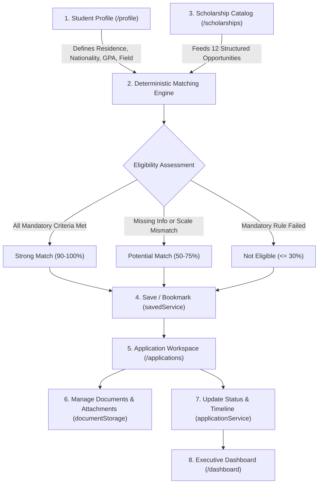

# GRANTLY — Rethinking the Scholarship Experience

[](https://react.dev/)
[](https://www.typescriptlang.org/)
[](https://vite.dev/)
[](https://tailwindcss.com/)
[](https://reactrouter.com/)
[](https://vitest.dev/)

> **Live Deployment:** [https://the-outpost-2026-ochre.vercel.app/](https://the-outpost-2026-ochre.vercel.app/)  
> **Source Repository:** [https://github.com/KrehantGajjar10/The-Outpost-2026](https://github.com/KrehantGajjar10/The-Outpost-2026)  
> **Event:** Frontend Arena — THE OUTPOST 2026

---

## Overview

Higher education financial assistance is fundamentally broken for students around the world. Scholarship opportunities are fragmented across hundreds of disparate foundation portals, university directories, government portals, and commercial aggregators. Students face opaque eligibility criteria, inconsistent grading conversions, conflicting document requirements, and unorganized deadlines.

**GRANTLY** reimagines this journey by unifying scholarship discovery, transparent eligibility evaluation, and end-to-end application management into a single, cohesive, client-side web application:

$$\textbf{Discover} \longrightarrow \textbf{Understand} \longrightarrow \textbf{Match} \longrightarrow \textbf{Save} \longrightarrow \textbf{Apply} \longrightarrow \textbf{Track}$$

Built specifically for **Frontend Arena — THE OUTPOST 2026**, GRANTLY is designed from first principles with a **region-neutral architecture**. It avoids US-centric or India-centric assumptions by treating international curricula, multi-currency funding models, and diverse grading systems as first-class citizens. GRANTLY runs entirely in the browser without requiring a backend database or user authentication server, storing your profile, bookmarks, applications, and document drafts securely in your browser's local storage.

---

## Table of Contents

- [1. The Problem and the Solution](#1-the-problem-and-the-solution)
- [2. Features](#2-features)
  - [Discover](#discover)
  - [Understand & Match](#understand--match)
  - [Manage Applications](#manage-applications)
  - [Stay Organized](#stay-organized)
  - [Experience & Interactions](#experience--interactions)
- [3. How It Works](#3-how-it-works)
  - [Product Workflow](#product-workflow)
  - [Deterministic Eligibility Matching Engine](#deterministic-eligibility-matching-engine)
  - [Browser-Local Persistence Architecture](#browser-local-persistence-architecture)
- [4. Tech Stack](#4-tech-stack)
- [5. Architecture](#5-architecture)
  - [Directory Structure](#directory-structure)
  - [Feature Boundaries & Design Patterns](#feature-boundaries--design-patterns)
- [6. Design System](#6-design-system)
  - [Color Palette & Tokens](#color-palette--tokens)
  - [Typography & Surfaces](#typography--surfaces)
  - [Motion & Accessibility](#motion--accessibility)
- [7. Performance](#7-performance)
  - [Code Splitting & Bundle Breakdown](#code-splitting--bundle-breakdown)
- [8. Accessibility](#8-accessibility)
  - [Measured Lighthouse Results](#measured-lighthouse-results)
- [9. Security and Data Handling](#9-security-and-data-handling)
- [10. Testing](#10-testing)
- [11. Getting Started](#11-getting-started)
- [12. Using the App](#12-using-the-app)
- [13. Data Note](#13-data-note)
- [14. Known Limitations and Roadmap](#14-known-limitations-and-roadmap)
- [15. AI-Assisted Development and Credits](#15-ai-assisted-development-and-credits)

---

## 1. The Problem and the Solution

| Challenge Faced by Students | How GRANTLY Solves It |
|---|---|
| **Scattered Scholarship Information**<br>Opportunities exist across hundreds of siloed portals, university bulletin boards, and non-profit websites. | **Unified Scholarship Catalog (`/scholarships`)**<br>A centralized, structured directory indexing funding amount, provider type, renewable terms, disbursement schedules, and eligibility rules in one uniform interface. |
| **Opaque Eligibility Rules**<br>Students spend hours parsing legalese only to find they fail a residency or grading cutoff. | **Deterministic Explainable Matching (`eligibilityEngine.ts`)**<br>Evaluates nationality, residency, education level, major, and GPA. Breaks down results into explicit *Satisfied*, *Failed*, and *Missing Info* criteria with plain-language explanations. |
| **Geographic & Educational Bias**<br>Most platforms assume US GPA (4.0) or Indian percentage marks and single-country currencies. | **Region-Neutral Data Model**<br>Supports GPA 4.0, GPA 5.0, Percentage, UK Honours classifications, and ungraded curricula across 6 currencies (`USD`, `EUR`, `GBP`, `CAD`, `INR`, `SGD`) without conflating exchange rates. |
| **Losing Track of Opportunities**<br>Students save links in scattered browser bookmarks or messy spreadsheets. | **Reactive Bookmarks & Pipeline (`savedService.ts`)**<br>One-click bookmarking synchronized across discovery cards, detail modals, command palette, and dashboard via custom browser DOM events. |
| **Disorganized Application Documents**<br>Missing transcripts, draft essays, or late recommendation letters result in disqualification. | **Dedicated Application Workspace (`/applications`)**<br>Structured checklists across 8 standard document categories, readiness metrics, and browser-local draft file attachments (up to 2MB). |
| **Missed Deadlines & Unclear Stages**<br>Students lose track of upcoming application cutoffs and milestone dates. | **Urgency Tracking & Application Timeline**<br>Dynamic deadline calculation with visual urgency tags (`urgent`, `upcoming`, `standard`, `expired`), notification center, and custom stage milestones. |

---

## 2. Features

### Discover

- **Comprehensive Scholarship Directory (`/scholarships`)**: Browse international scholarship opportunities with immediate feedback on deadlines, award values, and provider organizations.
- **Full-Text Live Search**: Instant search indexing titles, sponsors, descriptions, eligible fields of study, categories, and tags. Press `/` anywhere on the discovery page to focus search.
- **Multi-Attribute Filter Drawer**:
  - **Study Level**: Undergraduate, Master's, Doctorate / PhD, Vocational, Postdoctoral.
  - **Destination & Country**: Global, North America, Europe, Asia-Pacific, Commonwealth, etc.
  - **Field of Study**: STEM & Computing, Humanities, Business, Health & Life Sciences, etc.
  - **Funding Structure**: One-time grant, annual renewable, full tuition, monthly living stipend.
  - **Funding Range**: Preset bands (`< $5k`, `$5k – $10k`, `> $10k`).
  - **Eligibility Match**: Filter by `Strong Match`, `Potential Match`, or view all.
  - **Saved Only**: Instant toggle to view only bookmarked scholarships.
- **Deterministic Multi-Sort**: Sort by earliest deadline, furthest deadline, match relevance score, funding amount (high-to-low / low-to-high), or alphabetical order.
- **Deep Scholarship Detail Modal**: Inspect full funding terms, renewal requirements, disbursement schedules, required document checklists, and application guidelines.

### Understand & Match

- **Region-Neutral Student Profile (`/profile`)**: Configure country of residence, nationality, preferred destination countries, current institution, education level, field of study, and academic grading.
- **Multi-Scale Academic Support**: Handles 4.0 GPA, 5.0 GPA, Percentage (0–100%), UK Honours (First Class, 2:1, etc.), or Ungraded systems.
- **Self-Reported Equity Indicators**: Optional declarations for first-generation college student status and demonstrated financial need.
- **Dynamic Profile Completion Meter**: Visual progress indicator highlighting missing profile fields that unlock more precise matching assessments.
- **Explainable Match Evaluation**: Clear visual badge (`Strong Match`, `Potential Match`, `Not Eligible`) paired with an accordion breakdown of satisfied rules, failed criteria, and missing fields.

### Manage Applications

- **Application Management Workspace (`/applications`)**: A dedicated command center tracking all opportunities currently in your pipeline.
- **7-Stage Application Lifecycle**:
  - `planning`: Researching requirements and preparing prerequisites.
  - `in_progress`: Actively writing essays and gathering documents.
  - `submitted`: Application submitted to provider portal.
  - `under_review`: Application received and being evaluated by scholarship committee.
  - `accepted`: Award granted.
  - `rejected`: Application unsuccessful for current cycle.
  - `withdrawn`: Application voluntarily canceled.
- **Document Readiness Checklist**: Track status (`not_started`, `in_progress`, `ready`) across 8 core document categories:
  1. Official Academic Transcripts
  2. Proof of Enrollment / Student ID
  3. Curriculum Vitae / Resume
  4. Recommendation Letters
  5. Personal Statements / Essays
  6. Technical Portfolio / Work Repositories
  7. Financial Need Documentation
  8. Standardized Test Scores & Custom Documents
- **Browser-Local File Attachments**: Attach draft PDFs, DOCX files, or images directly to checklist items (up to 2MB). Files are encoded to Base64 Data URLs and stored locally in browser storage—no remote server upload.
- **Application Notes & Timeline**: Log timestamped milestones, notes, external portal reference codes, and custom submission targets.

### Stay Organized

- **Executive Dashboard (`/dashboard`)**: Unified overview displaying pipeline counts (Total Tracked, In Progress, Submitted, Accepted), upcoming deadlines timeline, quick bookmarks, and actionable tips.
- **Deadline Urgency Engine**: Dynamic day calculation that identifies overdue items, high-urgency deadlines ($\le 7$ days), upcoming cutoffs, and past cycles.
- **Notification Center**: In-app notifications alerting users to imminent deadlines, recommendation letter updates, and submission confirmations.
- **Global Command Palette (`Ctrl + K` / `Cmd + K`)**: Quick keyboard-driven modal to jump between pages, search scholarships directly, or view bookmarked grants from anywhere in the app.

### Experience & Interactions

- **Responsive Editorial Design**: Fluid layout tested across mobile, tablet, and desktop viewports with collapsible navigation drawers.
- **Focus Management & Modals**: Accessible focus-trapping dialogs with `Escape` key dismissal and focus restoration to trigger elements.
- **Accessible Color Contrast**: All text and interactive elements calibrated to meet WCAG AA contrast standards ($\ge 4.5:1$).
- **Reduced Motion Support**: Detects `prefers-reduced-motion` at the OS level to automatically simplify transitions and disable non-essential animations.

---

## 3. How It Works

### Product Workflow



### Deterministic Eligibility Matching Engine

The eligibility engine in [`src/features/eligibility/services/eligibilityEngine.ts`](file:///C:/Users/HP/VSCodeProjectsKrehant/OutpostKG/src/features/eligibility/services/eligibilityEngine.ts) is **pure, transparent, and deterministic**. It does not make external network requests or rely on probabilistic AI models.

The engine evaluates 7 independent criteria:

1. **Country of Residence (Mandatory)**: Evaluated independently from citizenship. Supports explicit country lists, regional groupings, or `GLOBAL`.
2. **Nationality Requirements (Mandatory)**: Evaluated independently from residence. A match in residence never bypasses a citizenship restriction.
3. **Education Level (Mandatory)**: Matches current study level against allowed levels (`undergraduate`, `masters`, `phd`, etc.).
4. **Field of Study (Mandatory)**: Matches student major against eligible disciplines, including intelligent STEM keyword expansion (e.g., Computer Science, Data, Engineering).
5. **Academic Minimum (Mandatory)**: Evaluates minimum scores. Handles compatible scales (normalizing GPA 4.0 and GPA 5.0). Flags incompatible scales (e.g., UK Honours vs GPA cutoff) as *Missing Info* requiring manual transcript review rather than generating an artificial score.
6. **Financial Need (Tri-State)**: Evaluates demonstrated need as `true`, `false`, or `undefined` (flagged as missing information).
7. **First-Generation Status (Tri-State)**: Evaluates first-in-family college status as `true`, `false`, or `undefined`.

#### Scoring Rules

- **Mandatory Failure**: Status becomes `not_eligible`. Score is strictly capped at $\le 30$.
- **Missing Information**: Status becomes `potential_match`. Score is capped at $\le 75$.
- **Optional Preference Failure** (e.g., study destination): Status becomes `potential_match`. Score is capped at $\le 80$.
- **All Criteria Satisfied**: Status becomes `strong_match`. Score is between $90\text{--}100$.

### Browser-Local Persistence Architecture

GRANTLY operates with zero external databases. All state persistence is handled in the user's browser using resilient, fault-tolerant services:

| Storage Key | Service & Event | Data Stored |
|---|---|---|
| `grantly_student_profile` | [`profileService.ts`](file:///C:/Users/HP/VSCodeProjectsKrehant/OutpostKG/src/features/profile/services/profileService.ts)<br>`grantly:profile_changed` | User's nationality, residence, GPA, degree level, and academic preferences. |
| `grantly_saved_scholarship_ids` | [`savedService.ts`](file:///C:/Users/HP/VSCodeProjectsKrehant/OutpostKG/src/features/saved/services/savedService.ts)<br>`grantly:saved_changed` | Array of bookmarked scholarship IDs. Initialized with 4 demo seeds on first visit. |
| `grantly_tracked_applications` | [`applicationService.ts`](file:///C:/Users/HP/VSCodeProjectsKrehant/OutpostKG/src/features/applications/services/applicationService.ts)<br>`grantly:application_changed` | Array of tracked applications, custom status labels, notes, target dates, and document checklists. |
| `grantly_doc_file_{docId}` | [`documentStorage.ts`](file:///C:/Users/HP/VSCodeProjectsKrehant/OutpostKG/src/features/applications/services/documentStorage.ts) | Base64-encoded local file attachments (up to 2MB per file). |
| `grantly_notifications` | [`notificationService.ts`](file:///C:/Users/HP/VSCodeProjectsKrehant/OutpostKG/src/services/notificationService.ts)<br>`grantly:notifications_changed` | Read/unread notification events and reminder triggers. |

The core [`storage.ts`](file:///C:/Users/HP/VSCodeProjectsKrehant/OutpostKG/src/services/storage.ts) wrapper safely wraps all `localStorage` reads and writes in `try/catch` blocks, preventing application crashes when storage quotas are exceeded, private browsing restrictions are active, or corrupted JSON is encountered.

---

## 4. Tech Stack

| Technology | Installed Version | Purpose in GRANTLY |
|---|---|---|
| **React** | `19.3.1` | Core UI library utilizing functional components, hooks, and Concurrent React primitives. |
| **TypeScript** | `6.0.3` | Strict static typing across domain models, service boundaries, and component props. |
| **Vite** | `8.3.6` | Next-generation frontend build tool providing instant HMR and optimized Rollup bundling. |
| **Tailwind CSS** | `4.3.5` | Modern CSS framework integrated via `@tailwindcss/vite` using `@theme` CSS tokens. |
| **React Router** | `7.18.5` | Client-side routing (`BrowserRouter`, `Routes`, `Route`, `useSearchParams`). |
| **Motion** | `14.10.1` | Production animation library for accessible modal transitions and layout animations. |
| **Lucide React** | `1.70.0` | Accessible, consistent vector icon set. |
| **Vitest** | `5.1.0` | High-speed unit test runner executed directly against TypeScript source modules. |
| **ESLint** | `10.14.0` | Code quality and React Hooks linting enforcement. |

*(Note: GRANTLY is an independent frontend application. It does not use Next.js, shadcn/ui, Base UI, or server-side frameworks.)*

---

## 5. Architecture

### Directory Structure

```
OutpostKG/
├── public/
│   ├── favicon.svg             # Custom emerald & forest brand monogram
│   ├── icons.svg               # SVG sprite sheet
│   ├── llms.txt                # Agentic documentation specification
│   └── robots.txt              # Web crawler access configuration
├── src/
│   ├── app/
│   │   ├── App.tsx             # Route declarations & lazy-loaded Command Palette
│   │   └── providers.tsx       # Root context providers
│   ├── components/
│   │   ├── shared/
│   │   │   ├── CommandPalette.tsx   # Global Ctrl+K navigation modal
│   │   │   ├── DemoNotice.tsx       # Prototype sample-data badge
│   │   │   ├── Footer.tsx           # Accessible region-neutral footer
│   │   │   └── Header.tsx           # Responsive header with mobile drawer
│   │   └── ui/
│   │       ├── Badge.tsx            # Multi-variant status & category badges
│   │       ├── Button.tsx           # Accessible button with loading/icon states
│   │       ├── Card.tsx             # Surface container with warm border tokens
│   │       ├── Input.tsx            # Form input & search bar
│   │       └── Modal.tsx            # Accessible focus-trapped dialog
│   ├── features/
│   │   ├── applications/
│   │   │   ├── components/          # Checklist, timeline, workspace modal, upload modal
│   │   │   ├── pages/               # ApplicationsPage.tsx (/applications)
│   │   │   ├── services/            # applicationService.ts, documentStorage.ts
│   │   │   └── types/               # application.ts
│   │   ├── dashboard/
│   │   │   ├── components/          # Metrics overview, opportunity list, deadlines timeline
│   │   │   ├── pages/               # DashboardPage.tsx (/dashboard)
│   │   │   └── types/               # dashboard.ts
│   │   ├── eligibility/
│   │   │   ├── components/          # EligibilityBadge.tsx, EligibilityBreakdownCard.tsx
│   │   │   ├── services/            # eligibilityEngine.ts & eligibilityEngine.test.ts
│   │   │   └── types/               # eligibility.ts
│   │   ├── landing/
│   │   │   ├── components/          # HeroSection, HowItWorksSection, BenefitsSection, CtaSection
│   │   │   └── pages/               # LandingPage.tsx (/)
│   │   ├── profile/
│   │   │   ├── components/          # ProfileForm.tsx
│   │   │   ├── data/                # defaultProfile.ts
│   │   │   ├── pages/               # ProfilePage.tsx (/profile)
│   │   │   ├── services/            # profileService.ts & profileService.test.ts
│   │   │   └── types/               # profile.ts
│   │   ├── saved/
│   │   │   └── services/            # savedService.ts & savedService.test.ts
│   │   └── scholarships/
│   │       ├── components/          # ScholarshipCard.tsx, ScholarshipDetailsView.tsx, FilterDrawer.tsx
│   │       ├── data/                # mockScholarships.ts (12 detailed demo grants)
│   │       ├── hooks/               # useScholarshipFilters.ts & useScholarshipFilters.test.ts
│   │       ├── pages/               # DiscoveryPage.tsx (/scholarships)
│   │       └── types/               # scholarship.ts
│   ├── hooks/
│   │   ├── useReducedMotion.ts      # Browser prefers-reduced-motion media query hook
│   │   └── useScholarshipPipeline.ts # Chapter 01 pipeline state & metrics hook
│   ├── lib/
│   │   ├── utils.ts                 # Dynamic date math, currency formatting, classnames
│   │   └── utils.test.ts            # Date & currency unit tests
│   ├── services/
│   │   ├── notificationService.ts   # In-app notification management & tests
│   │   └── storage.ts               # Resilient localStorage abstraction & tests
│   ├── styles/
│   │   └── index.css                # Tailwind CSS v4 design tokens and global styles
│   └── main.tsx                     # React application mounting entry point
├── eslint.config.js
├── index.html
├── package.json
├── tsconfig.json
├── vercel.json                      # SPA route rewrite fallback
└── vite.config.ts                   # Manual Rollup vendor chunk splitting
```

### Feature Boundaries & Design Patterns

1. **Feature-Based Modular Structure**: Each domain (`scholarships`, `applications`, `profile`, `eligibility`, `dashboard`, `landing`) encapsulates its own components, pages, services, types, and unit tests.
2. **Cross-Feature Decoupling via DOM Events**: Features communicate state mutations across routes through standard browser events (`grantly:profile_changed`, `grantly:saved_changed`, `grantly:application_changed`). This enables instant reactivity without introducing heavy external state management libraries like Redux.
3. **Pure Domain Engines**: The eligibility evaluator and date calculator are implemented as pure, side-effect-free functions, making them 100% testable and predictable.

---

## 6. Design System

GRANTLY features an original, polished visual identity inspired by classic academic editorial publications and modern financial platforms.

### Color Palette & Tokens

Configured in [`src/styles/index.css`](file:///C:/Users/HP/VSCodeProjectsKrehant/OutpostKG/src/styles/index.css) using Tailwind CSS v4 `@theme` directives:

- **Deep Forest Green** (Primary Brand & Structure):
  - `forest-950` (`#061c14`) — Contrast headers, footers, and text emphasis.
  - `forest-900` (`#0a2e22`) — Primary brand surface and buttons.
  - `forest-800` (`#124332`) — Interactive hover states.
  - `forest-700` (`#195b45`) — Focus visible outlines and borders.
  - `forest-50` (`#edfbf4`) — Subtle green tint backgrounds.
- **Warm Stone Neutrals** (Backgrounds & Paper Surfaces):
  - `warm-50` (`#faf9f6`) — Application background ("Warm Paper").
  - `warm-100` (`#f4f1ea`) — Muted card backgrounds.
  - `warm-200` (`#e7e2d7`) — Card dividers and borders.
  - `warm-300` (`#d2cbbf`) — Input borders and scrollbar thumb.
  - `warm-500` (`#70685d`) — Secondary body text (calibrated to **5.29:1** contrast).
  - `warm-900` (`#1c1916`) — Primary body typography.
- **Emerald Accents** (Success & Match Ratings):
  - `emerald-600` (`#047857`) — High-contrast success text (**5.32:1** on `#faf9f6`).
  - `emerald-500` (`#10b981`) — Vibrant badge accents.
  - `emerald-50` (`#ecfdf5`) — Match card indicator backgrounds.
- **Amber Accents** (Urgency & Warnings):
  - `amber-accent` (`#b45309`) — High-contrast approaching deadline alerts.
  - `amber-light` (`#fef3c7`) — Urgency badge backgrounds.

### Typography & Surfaces

- **Font Family**: Modern system typography stack (`-apple-system, BlinkMacSystemFont, "Segoe UI", Roboto, "Helvetica Neue", Arial, sans-serif`) with serif accents on monogram branding and editorial section titles.
- **Accessible Focus Rings**: Explicit 2px forest outline on all interactive buttons, links, and form inputs:
  ```css
  :focus-visible {
    outline: 2px solid #195b45;
    outline-offset: 2px;
  }
  ```
- **Custom Scrollbar**: Minimalist 6px track with rounded `#d2cbbf` thumb.

### Motion & Accessibility

- Animated transitions using `motion/react` for card hovers, modal overlays, and drawer expansions.
- Fully integrated with [`useReducedMotion`](file:///C:/Users/HP/VSCodeProjectsKrehant/OutpostKG/src/hooks/useReducedMotion.ts) to disable or instantly complete animations when users request reduced motion.

---

## 7. Performance

GRANTLY is optimized for near-instant client-side loading through Vite 8's build pipeline, asynchronous route splitting, and selective vendor chunk isolation.

### Code Splitting & Bundle Breakdown

Routes and heavy overlays are split using `React.lazy()` and `Suspense`, preventing discovery mock data or command menu code from bloating the initial landing page.

Production build verification output (`npm run build`):

```
vite v8.3.6 building client environment for production...
transforming...
✓ 2547 modules transformed.

dist/index.html                             1.18 kB │ gzip:  0.59 kB
dist/assets/index-Ctih2nNi.css             55.06 kB │ gzip:  9.77 kB
dist/assets/useReducedMotion-CCcS797L.js    0.51 kB │ gzip:  0.30 kB
dist/assets/storage-I70Ku5Wr.js             0.61 kB │ gzip:  0.26 kB
dist/assets/Card-DS4LICAZ.js                0.75 kB │ gzip:  0.45 kB
dist/assets/savedService-Dp4b0FTY.js        0.96 kB │ gzip:  0.45 kB
dist/assets/Badge-C9yomJAn.js               2.21 kB │ gzip:  0.89 kB
dist/assets/DemoNotice-ZAGNNg4h.js          2.30 kB │ gzip:  1.18 kB
dist/assets/AnimatePresence-CelWF78X.js     5.00 kB │ gzip:  2.33 kB
dist/assets/CommandPalette-BP_LIA4L.js      5.65 kB │ gzip:  2.09 kB
dist/assets/Footer-CYI3aoBD.js              9.63 kB │ gzip:  2.25 kB
dist/assets/Modal-BMVezWiU.js              17.71 kB │ gzip:  5.51 kB
dist/assets/ProfilePage-BHPylR8j.js        18.63 kB │ gzip:  4.28 kB
dist/assets/LandingPage-BaEiu0rh.js        20.28 kB │ gzip:  5.15 kB
dist/assets/mockScholarships-o4UmWRh8.js   21.35 kB │ gzip:  6.13 kB
dist/assets/vendor-icons-B18qIGma.js       23.22 kB │ gzip:  8.55 kB
dist/assets/ApplicationsPage-BPwKs6T5.js   47.07 kB │ gzip: 11.03 kB
dist/assets/DashboardPage-DeVfAclr.js      48.49 kB │ gzip: 11.00 kB
dist/assets/index-CXjnTo34.js              49.00 kB │ gzip: 17.64 kB
dist/assets/DiscoveryPage-CJc09EF9.js      52.24 kB │ gzip: 11.22 kB
dist/assets/vendor-motion-DNHNCPbm.js     135.51 kB │ gzip: 45.41 kB
dist/assets/vendor-react-qSgQ1SO8.js      210.53 kB │ gzip: 65.70 kB

✓ built in 300ms
```

---

## 8. Accessibility

GRANTLY has undergone thorough accessibility tuning to ensure students using screen readers, keyboard navigation, or high-contrast settings can navigate the platform effectively:

- **Strict Heading Hierarchy**: Structured single `h1` per view descending sequentially to `h2` and `h3` sections without level skipping.
- **WCAG AA Color Contrast**: All neutral and accent text tokens meet or exceed the 4.5:1 ratio against light backgrounds (`warm-500` at 5.29:1, `emerald-600` at 5.32:1, `#be123c` deadline warnings at 5.92:1).
- **Accessible Name Parity**: Eliminates `label-content-name-mismatch` by aligning visible button/link text with screen reader accessible names and hiding decorative SVG monograms (`aria-hidden="true"`).
- **Focus Trapping**: Modals and drawers trap keyboard focus while active and return focus to the trigger button upon dismissal.
- **Search Engine & Agent Discoverability**: Includes [`public/robots.txt`](file:///C:/Users/HP/VSCodeProjectsKrehant/OutpostKG/public/robots.txt) and [`public/llms.txt`](file:///C:/Users/HP/VSCodeProjectsKrehant/OutpostKG/public/llms.txt).

### Measured Lighthouse Results

*Historical benchmark measured on local production preview (`vite preview`) via Lighthouse v13.6.0:*

| Category | Desktop Score | Mobile Score |
|---|:---:|:---:|
| **Performance** | **100** | **98** |
| **Accessibility** | **100** | **100** |
| **Best Practices** | **100** | **100** |
| **SEO** | **100** | **100** |
| **Agentic Browsing** | **3/4 (75%)** | **3/4 (75%)** |

*(Note: Actual Lighthouse scores may vary slightly based on client CPU throttling, network conditions, and device emulation environments.)*

---

## 9. Security and Data Handling

GRANTLY is deliberately architected as a **privacy-conscious, client-side frontend application**:

- **No Remote Database or Account Tracking**: No central database collects or stores your personal student data, GPA, or financial need declarations.
- **Browser-Local Storage**: Student profiles, bookmarked scholarships, application notes, and checklist statuses are stored exclusively on your device via standard `window.localStorage`.
- **Local Document Attachments**: Document drafts attached to application checklists are stored in your browser using Data URLs. Files are **never uploaded to a remote server**.
- **Attachment Quota Limits**: File attachments are restricted to a maximum of **2MB per file** to respect browser storage constraints.
- **External Application Boundary**: GRANTLY is a management workspace. It **does not submit applications** to external universities or scholarship foundations on your behalf; users must submit officially via the provider's official portal.

---

## 10. Testing

GRANTLY maintains automated unit test coverage across all core business logic, matching algorithms, date math, and storage persistence.

Run the test suite using:
```bash
npm test
```

### Verified Test Suite Results

```
Test Files  10 passed (10)
     Tests  60 passed (60)
  Duration  8.68s
```

| Test File | Tests | Area Covered |
|---|:---:|---|
| [`src/features/eligibility/services/eligibilityEngine.test.ts`](file:///C:/Users/HP/VSCodeProjectsKrehant/OutpostKG/src/features/eligibility/services/eligibilityEngine.test.ts) | 12 | Independent nationality & residency rules, GPA cutoff logic, grading scale compatibility, tri-state financial need. |
| [`src/features/applications/services/applicationService.test.ts`](file:///C:/Users/HP/VSCodeProjectsKrehant/OutpostKG/src/features/applications/services/applicationService.test.ts) | 9 | Application lifecycle transitions, custom stages, document checklist mutations, corrupted storage recovery. |
| [`src/features/scholarships/hooks/useScholarshipFilters.test.ts`](file:///C:/Users/HP/VSCodeProjectsKrehant/OutpostKG/src/features/scholarships/hooks/useScholarshipFilters.test.ts) | 8 | Full-text query search, multi-facet filtering (degree, country, award type), deterministic multi-sorting. |
| [`src/services/notificationService.test.ts`](file:///C:/Users/HP/VSCodeProjectsKrehant/OutpostKG/src/services/notificationService.test.ts) | 6 | In-app alerts, read state toggles, duplicate prevention, corrupted JSON recovery. |
| [`src/lib/utils.test.ts`](file:///C:/Users/HP/VSCodeProjectsKrehant/OutpostKG/src/lib/utils.test.ts) | 6 | Dynamic date math, ISO date parsing, currency formatting, nationality & country matching algorithms. |
| [`src/features/applications/services/documentStorage.test.ts`](file:///C:/Users/HP/VSCodeProjectsKrehant/OutpostKG/src/features/applications/services/documentStorage.test.ts) | 4 | Local file attachment persistence, 2MB size limit enforcement, Base64 encoding. |
| [`src/hooks/useScholarshipPipeline.test.ts`](file:///C:/Users/HP/VSCodeProjectsKrehant/OutpostKG/src/hooks/useScholarshipPipeline.test.ts) | 4 | Dashboard pipeline state, metric aggregations, saved scholarship integration. |
| [`src/features/profile/services/profileService.test.ts`](file:///C:/Users/HP/VSCodeProjectsKrehant/OutpostKG/src/features/profile/services/profileService.test.ts) | 4 | Student profile reads, updates, default seeding, and malformed data recovery. |
| [`src/services/storage.test.ts`](file:///C:/Users/HP/VSCodeProjectsKrehant/OutpostKG/src/services/storage.test.ts) | 4 | Fault-tolerant localStorage wrapper handling storage exceptions and malformed JSON payloads. |
| [`src/features/saved/services/savedService.test.ts`](file:///C:/Users/HP/VSCodeProjectsKrehant/OutpostKG/src/features/saved/services/savedService.test.ts) | 3 | Bookmark addition, removal, toggling, and event broadcasting. |

---

## 11. Getting Started

### Prerequisites

- **Node.js**: Version `18.0.0` or higher (Node `20.x` or `22.x` recommended).
- **npm**: Version `9.x` or higher.

### Installation

1. **Clone the repository:**
   ```bash
   git clone https://github.com/KrehantGajjar10/The-Outpost-2026.git
   cd The-Outpost-2026
   ```

2. **Install project dependencies:**
   ```bash
   npm install
   ```

3. **Start the local development server:**
   ```bash
   npm run dev
   ```
   Open your browser and navigate to `http://localhost:5173`.

### Available Scripts

| Script | Command | Purpose |
|---|---|---|
| `dev` | `npm run dev` | Starts Vite HMR dev server at `http://localhost:5173`. |
| `build` | `npm run build` | Runs TypeScript type check (`tsc -b`) and builds production bundle (`vite build`). |
| `lint` | `npm run lint` | Runs ESLint across all TypeScript and React source files. |
| `test` | `npm test` | Runs the full Vitest automated test suite once. |
| `preview` | `npm run preview` | Spins up a local production server to test the built `dist/` directory. |

---

## 12. Using the App

Explore the complete student journey across GRANTLY's 5 verified routes:

### 1. Landing Page (`/`)
- Understand the product's mission through the interactive hero section.
- View real-time platform statistics and sample scholarship previews.
- Jump directly into finding scholarships or opening the student workspace.

### 2. Discover Scholarships (`/scholarships`)
- Search through 12 diverse international scholarships.
- Filter by your educational level, study destination, or award type.
- Toggle the **Saved Only** filter to review bookmarked opportunities.
- Click any scholarship card to open the deep inspection modal and examine required documents and deadlines.
- Use the keyboard shortcut `/` to immediately focus the search bar.

### 3. Build Your Student Profile (`/profile`)
- Enter your nationality, country of residence, and current institution.
- Set your degree level and academic grading scale (GPA 4.0, 5.0, Percentage, or UK Honours).
- Save your profile—all matching scores across `/scholarships` and `/dashboard` immediately re-calculate without a page reload.

### 4. Application Workspace (`/applications`)
- View and manage scholarships in your active application pipeline.
- Update application stages (`planning`, `in_progress`, `submitted`, `under_review`, `accepted`).
- Track document checklists across transcripts, essays, recommendation letters, and portfolios.
- Attach local draft files (up to 2MB) for quick reference.
- Add personal notes, submission deadlines, and portal confirmation codes.

### 5. Executive Dashboard (`/dashboard`)
- Review high-level pipeline metrics (Total Tracked, In Progress, Submitted, Accepted).
- Inspect the deadline timeline to prioritize applications due in the next 7 days.
- Read in-app alerts and notifications.

### Global Shortcuts
- **`Ctrl + K` / `Cmd + K`**: Open the global Command Palette from any page.
- **`Escape`**: Close any active modal, drawer, or command menu.

---

## 13. Data Note

All scholarship records, foundation names, funding programs, and student demonstration profiles in GRANTLY are **simulated prototype demonstration data**:

- **Catalog Size**: GRANTLY currently includes **12 demonstration scholarships** spanning 6 currencies (`USD`, `EUR`, `GBP`, `CAD`, `INR`, `SGD`) and diverse disciplines (STEM, green technology, civic policy, health equity, first-generation grants).
- **Not a Live Feed**: Opportunities are not guaranteed to be active or funded by the listed entities.
- **Informational Estimates**: Eligibility evaluations are deterministic estimates based solely on user-entered profile data and do not constitute an official award determination.
- **External Applications**: Users must submit formal applications directly through the respective scholarship provider's official portal.

---

## 14. Known Limitations and Roadmap

### Current Limitations (Frontend-Only Architecture)

- **Browser-Bound Persistence**: Data is saved to the local browser's `localStorage`. Clearing browser data or opening the site in a private window resets state to default seeds.
- **No Cross-Device Synchronization**: Data does not sync between your mobile phone and laptop without a backend account server.
- **Local Attachment Size Limit**: Document attachments are restricted to 2MB per file to prevent browser storage exhaustion.
- **Simulated Catalog**: Opportunities represent a demonstration catalog rather than a live external API feed.

### Planned Roadmap

- [ ] **Data Export & Import**: Allow students to export their profile and tracked applications to a portable JSON backup file and restore it on another device.
- [ ] **Live API Integrations**: Partner with open scholarship databases and educational bodies for verified live opportunity feeds.
- [ ] **Calendar Export (`.ics`)**: Download deadline reminders directly into Google Calendar, Apple Calendar, or Outlook.
- [ ] **Side-by-Side Scholarship Comparison**: Compare funding terms, renewal conditions, and document requirements across multiple scholarships simultaneously.
- [ ] **IndexedDB Document Storage**: Upgrade from `localStorage` Data URLs to IndexedDB for larger document drafts and offline caching.

---

## 15. AI-Assisted Development and Credits

- **Hackathon**: Developed for **Frontend Arena — THE OUTPOST 2026**.
- **AI-Assisted Pair Programming**: Built with the assistance of **Antigravity** (Google DeepMind) as an agentic AI coding companion for architecture design, rapid prototyping, and automated testing.
- **Icons**: [Lucide Icons](https://lucide.dev/).
- **Animation**: [Motion](https://motion.dev/).
- **Developer**: Krehant Gajjar ([@KrehantGajjar10](https://github.com/KrehantGajjar10)).
